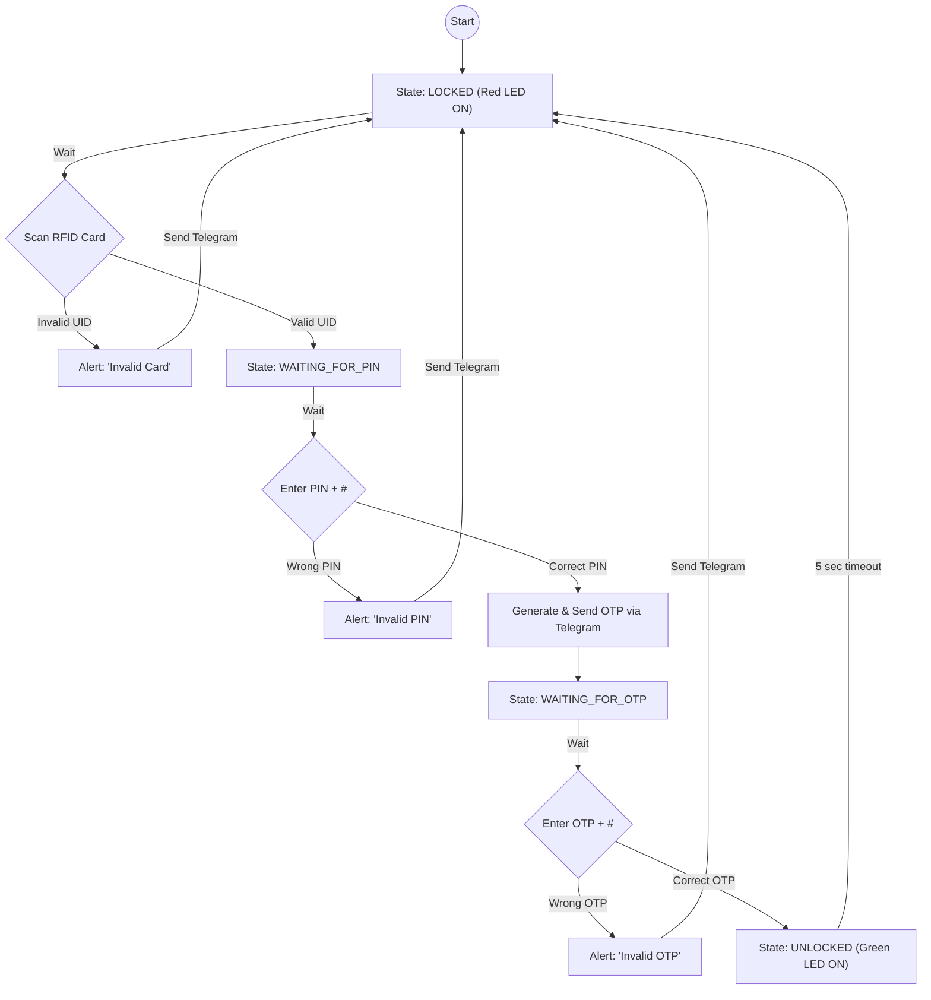

# Digital-Lock-with-Multi-factor-Authentication
---
## Abstract
With the rapid rise of automation and smart devices, ensuring reliable and secure access control has
become an essential aspect of modern embedded systems. Traditional single-layer authentication
methods such as passwords or RFID tags alone are increasingly vulnerable to breaches, making
multi-factor authentication a more robust and necessary alternative for safeguarding both digital and
physical environments.
This project presents a Triple Authentication Digital Lock System built on the ESP32 microcontroller,
integrating RFID-based identification, keypad PIN entry, and Telegram-based One-Time Password
(OTP) verification. The system validates users sequentially through these three stages, granting access
only upon successful completion of all checks. Implemented in MicroPython, the prototype employs
an MFRC522 RFID module, 4×4 matrix keypad, and Wi-Fi connectivity for Telegram integration. It
also includes real-time alert notifications, LED status indication, and an automatic timeout mechanism
for enhanced reliability. The project demonstrates how low-cost microcontrollers can effectively
combine embedded hardware and IoT capabilities to deliver secure, scalable, and smart access
solutions for real-world applications.
---
## Introduction
In today’s world of rapidly advancing technology, the need for secure and intelligent access control
systems has become more important than ever. From residential buildings and office environments to
laboratories and data centers, preventing unauthorized entry has emerged as a critical concern.
Traditional single-layer authentication mechanisms such as physical keys, RFID cards, or numeric
passwords are increasingly vulnerable to duplication, hacking, and human error. These limitations
have led to the evolution of multi-factor authentication (MFA) , a process that requires users to verify
their identity through multiple independent methods before access is granted.
Multi-factor authentication enhances system security by combining multiple credentials — typically
something the user has (e.g., RFID card), something the user knows (e.g., password or PIN), and
something the user receives (e.g., a time-sensitive OTP). This layered verification approach ensures
that even if one factor is compromised, unauthorized access remains difficult. The principle of MFA
has become the foundation of secure systems used by banks, research labs, and IoT-based smart
environments.
In this project, a Triple Authentication Digital Lock System has been designed and implemented using
the ESP32 microcontroller as the core processing unit. The system integrates three different security
layers. RFID card verification, keypad-based PIN entry, and Telegram-based One-Time Password
(OTP) verification to ensure a robust and reliable security mechanism. Each authentication stage is
dependent on the successful completion of the previous one, thereby reducing the chances of
intrusion.
The ESP32 was selected due to its dual-core processing capability, built-in Wi-Fi and Bluetooth
modules, and ease of programming with MicroPython. These features make it ideal for developing
IoT-enabled embedded systems where both local hardware interfacing and cloud-based
communication are required. The MFRC522 RFID module is used for card-based identification via
SPI communication, while a 4×4 matrix keypad provides user input for PIN and OTP entry. Visual
indicators in the form of red and green LEDs display system states such as locked, unlocked, or
invalid access.
A unique feature of this project is the integration of Telegram messaging as part of the authentication
process. Upon successful PIN entry, the ESP32 generates a six-digit random OTP and sends it to the
user via a Telegram bot using the Telegram API over Wi-Fi. The user must then enter the received
OTP on the keypad to complete authentication. Telegram also provides real-time notifications for
system events, such as invalid card detection, failed login attempts, or successful unlock
confirmations, allowing remote monitoring and control.
The entire system operates sequentially: the user first scans an RFID card, then enters a 4-digit PIN,
and finally inputs the OTP received on Telegram. Any mismatch at any stage prevents access and
triggers a visual alert along with a message notification. The implementation demonstrates how
embedded systems, when integrated with IoT services, can deliver advanced, multi-layered, and
user-friendly security solutions.
Overall, this project showcases how low-cost hardware and open-source software can be combined
to build a highly effective smart locking system. It not only meets the requirements of a modern
access control mechanism but also provides a scalable foundation for future enhancements, such as
fingerprint sensors, mobile app control, and cloud-based data logging.
## Objective
The primary objective of this project is to design and develop a multi-factor authentication digital
lock system that enhances the security and reliability of access control using the ESP32
microcontroller. The system combines multiple layers of verification to minimize the risk of
unauthorized access and to demonstrate the integration of embedded hardware with IoT-based
communication.
The specific objectives of the project are as follows:
1. To design a triple authentication system that uses three independent verification
methods — RFID card detection, PIN entry through a keypad, and OTP verification
via Telegram — to ensure a high level of access security.
2. To interface the ESP32 microcontroller with external hardware modules such as
the MFRC522 RFID reader, a 4×4 matrix keypad, and LED indicators for visual
feedback, demonstrating proper use of GPIO and SPI communication protocols.
3. To integrate IoT functionality using Wi-Fi connectivity, enabling the ESP32 to
communicate with the Telegram cloud API for sending One-Time Passwords (OTP)
and system notifications in real-time.
4. To implement a user authentication workflow where each stage (RFID → PIN →
OTP) must be successfully completed before unlocking, ensuring logical sequencing
and validation of inputs.
5. To provide visual status feedback through red and green LEDs, representing the
lock’s state (locked, unlocked, or access denied), and an internal LED for Wi-Fi
connectivity indication.
6. To ensure system robustness by including features such as timeout handling, input
cancellation (via keypad), and invalid card detection alerts through Telegram
messages.
7. To demonstrate the practical application of MicroPython in embedded system
design, emphasizing modular coding, real-time operation, and cloud communication.
8. To develop a scalable and low-cost security prototype that can be adapted for
various environments, including residential, institutional, and industrial access
control systems.
## Circuit Design
The circuit design of the ESP32-based Digital Lock System integrates multiple hardware modules to
achieve a secure, multi-factor authentication process. The ESP32 serves as the main processing unit
that coordinates inputs from both the RFID reader and the 4×4 matrix keypad, performs logical
verification, and controls the visual indicators. The RC522 RFID module allows contactless
identification of authorized users, while the keypad provides secondary PIN or OTP verification. In
addition to these input modules, the system is equipped with two indicator LEDs and an onboard
Wi-Fi interface that enables communication with a Telegram bot for remote verification and alert
notifications.
The overall design emphasizes modularity, compactness, and reliability. Each peripheral component
communicates with the ESP32 through dedicated GPIO pins, ensuring minimal interference between
devices. The SPI protocol is used for communication between the ESP32 and the RC522 module,
offering fast and stable data transfer. The keypad is interfaced through general-purpose I/O pins,
configured for row-column scanning. The red and green LEDs are connected through current-limiting
resistors to visually indicate system states such as “locked”, “unlocked”, and “authentication failed.

## Pin Configuration
### RFID Module RC522
| RC522 Pin | ESP32 Pin |
| :--- | :--- |
| 3.3V | 3V3 |
| GND | GND |
| SCK | GPIO18 |
| MOSI | GPIO23 |
| MISO | GPIO19 |
| SDA | GPIO21 |
| RST | GPIO22 |
### 4x4 Matrix Keypad
| Keypad Pin | ESP32 Pin |
| :--- | :--- |
| R1 | GPIO 32 |
| R2 | GPIO 33 |
| R3 | GPIO 25 |
| R4 | GPIO 26 |
| C1 | GPIO 27 |
| C2 | GPIO 14 |
| C3 | GPIO 12 |
| C4 | GPIO 13 |
### Led Indicators
| Component | ESP32 Pin | Purpose |
| :--- | :--- | :--- |
| Red LED | GPIO 5 | Locked / Access Denied |
| Green LED | GPIO 2 | Unlocked / Access Granted |
## Flowchart

## Conclusion
The multi-factor authentication digital lock system was successfully designed, implemented, and tested. The project demonstrates a practical and effective application of integrating embedded hardware (ESP32, RFID, Keypad) with IoT capabilities (Telegram API) to create a secure, reliable, and user-friendly access control system. The combination of RFID, PIN, and OTP verification provides a robust layered security mechanism that is superior to single-factor locks.
